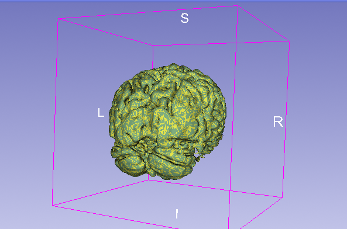
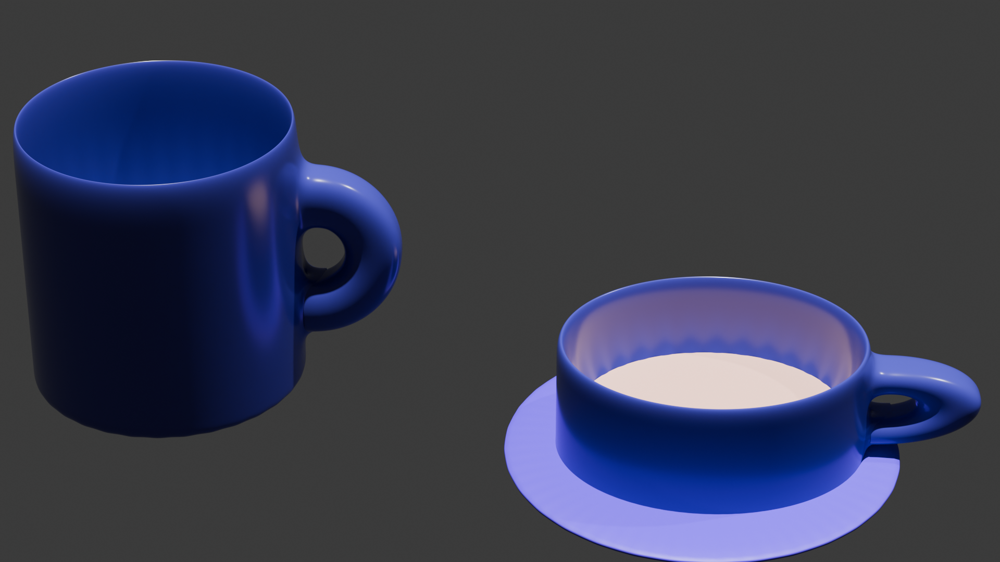
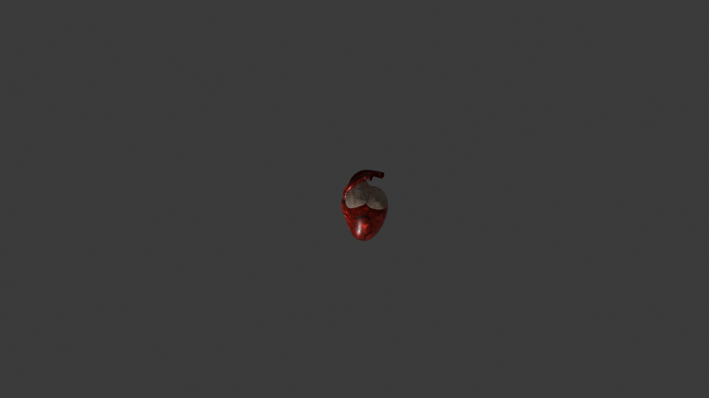
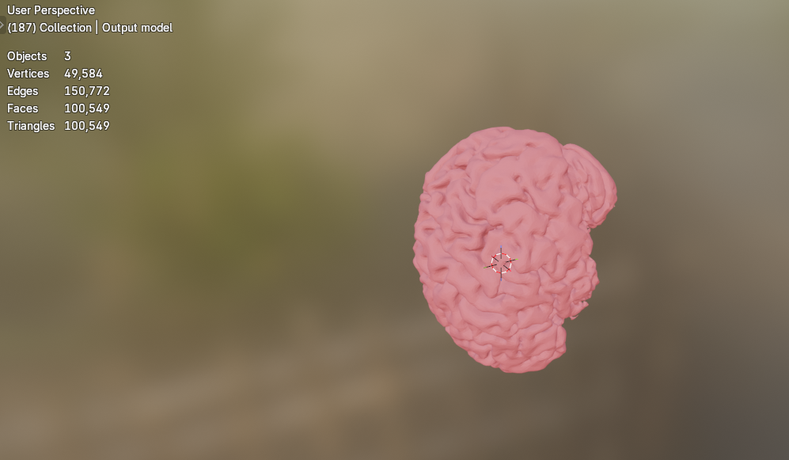

# Augmented Visualization in Medicine — Project Portfolio

A collection of seven practical projects developed during the Augmented Visualization in Medicine course at FH Kärnten (Carinthia University of Applied Sciences). The projects cover medical image segmentation, 3D modelling, anatomical animation, interactive simulation, volume rendering, augmented reality (AR), and extended reality (XR).

**Technologies:** 3D Slicer · Blender · Unity · C# · Vuforia · OpenXR · XR Interaction Toolkit

## Projects

| Project | Main technical focus |
| --- | --- |
| [MRI Brain Segmentation](MRI-Brain-Segmentation-3DSlicer/) | MRI segmentation, surface reconstruction and mesh decimation |
| [3D Modeling and Rendering](Blender-3D-Modeling-and-Rendering/) | Mesh modelling, materials, lighting and Cycles rendering |
| [Anatomical Modeling and Animation](Anatomical-Modeling-and-Animation/) | Heart sculpting, shape-key animation and brain mesh optimization |
| [Unity Roll-a-Ball Game](Unity-Roll-a-Ball-Game/) | C# gameplay, physics, enemy navigation and scene management |
| [Medical Volume Rendering](Medical-Volume-Rendering/) | Interactive volumetric visualization and anatomical slice navigation |
| [AR Brain Visualization](AR-Brain-Visualization-Vuforia/) | Image-target tracking and interactive anatomical models |
| [XR Medical Interaction](XR-Medical-Interaction/) | Unity XR environment and interaction toolkit integration |

## 1. MRI Brain Segmentation and 3D Reconstruction

**Tools:** 3D Slicer, Swiss Skull Stripper, Segment Editor

Created a 3D brain surface from the `MRBrainTumor2` example MRI dataset. The workflow included skull stripping, threshold-based segmentation, margin shrinking, joint smoothing and removal of small islands. The resulting segmentation was converted into a surface model and decimated using FastQuadric (target reduction factor: 0.8), then exported as a Wavefront OBJ for downstream visualization in Blender and Unity.

[Exported OBJ model](MRI-Brain-Segmentation-3DSlicer/Output%20model.obj) · [Decimation output](MRI-Brain-Segmentation-3DSlicer/images/brain-decimated-obj-file.png)

## 2. Blender 3D Modeling and Rendering

**Tools:** Blender, Cycles

Modelled a porcelain mug, cappuccino cup, coffee surface and saucer. Used extrusion, inset faces, loop cuts, subdivision surfaces and the Spin tool for handle construction. Configured materials, lighting and camera placement and rendered the final scene using Cycles.

[Blender project](Blender-3D-Modeling-and-Rendering/Cappuccino%20cup_saucer_with_coffee.blend) · [Alternative lighting render](Blender-3D-Modeling-and-Rendering/blender_1_cup_with_coffee_light.png)

## 3. Anatomical Modeling and Animation

**Tools:** Blender, sculpting, Bézier curves, shape keys

### Heart modelling and heartbeat animation

Constructed a heart model using front and side reference images, sculpted the main body and atria, and modelled blood vessels with Bézier curves converted to meshes. Applied material and texture adjustments and created a contraction/expansion animation using shape keys and timeline keyframes over 60 frames.

[Blender project](Anatomical-Modeling-and-Animation/Excercise-1/heart_beating.blend) · [Heartbeat animation](Anatomical-Modeling-and-Animation/Excercise-1/output/0001-0060.mkv)

### Brain mesh optimization

Imported the segmented brain from Project 1, applied object scale, removed loose geometry and merged nearby vertices using Merge by Distance. Used scene statistics to inspect vertex counts and preserved the anatomical shape while preparing a material-preview visualization.

## 4. Unity Roll-a-Brain Game

**Tools:** Unity, C#, Input System, Rigidbody, NavMeshAgent, TextMeshPro

Developed an interactive multi-scene game with physics-based player movement, collectible objects, enemy behaviour and environmental hazards. Implemented force-based movement in `FixedUpdate`, trigger-based pickup counting, collision-based failure conditions, camera following and delayed scene transitions. Enemy scripts include continuous NavMesh-based pursuit and proximity-triggered Rigidbody movement. Collecting all pickups triggers the level completion logic.

[Gameplay scripts](Unity-Roll-a-Ball-Game/Assignment_Unity_Roll-a-Ball/Assets/Scripts/)

## 5. Medical Volume Rendering

**Tools:** Unity, C#, UnityVolumeRendering package

Integrated a volume rendering package and implemented a custom viewer controller for interactive exploration. The interface supports toggling the 3D volume, selecting axial, coronal and sagittal slices, moving the active slice with a slider, resetting its position and synchronizing a cross-section plane with the selected slice.

[Viewer controller](Medical-Volume-Rendering/VolumeRendering_Assignment/Assets/Scripts/VolumeViewerController.cs) · [Demo video](Medical-Volume-Rendering/Volume_rendering.mp4)

## 6. Augmented Reality Brain Visualization

**Tools:** Unity, C#, Vuforia Engine

Developed an image-target-based AR brain visualization project. The C# scripts implement keyboard-driven rotation and scaling, sinusoidal pulsing with start/stop controls, and material colour changes based on image-target tilt. These interactions provide different ways to inspect and animate the anatomical model.

[Interaction scripts](AR-Brain-Visualization-Vuforia/Assets/Scripts/) · [Demo video](AR-Brain-Visualization-Vuforia/Vuforia_Brain_Asiignment.mp4) · [Additional recording](AR-Brain-Visualization-Vuforia/Vuforia_Brain_Asiignment_part_1.mp4)

## 7. XR Medical Interaction

**Tools:** Unity, XR Interaction Toolkit, OpenXR

Explored XR interaction in a medical visualization coursework exercise using Unity's XR packages. The repository includes the Unity project configuration and a recorded demonstration of the exercise.

[Demo video](XR-Medical-Interaction/XRInteraction_Assignment.mp4)

## Opening the projects

- **3D Slicer:** Import the exported OBJ to inspect the reconstructed brain surface. The original MRI dataset is not included in the repository.
- **Blender:** Open the respective `.blend` files; external textures may need to be relinked.
- **Unity:** Open the relevant project directory (the directory containing `Assets`, `Packages` and `ProjectSettings`) using Unity Hub. The archived projects specify Unity `6000.4.6f1`. Allow Unity to restore dependencies. The Vuforia project requires a compatible Vuforia package and your own license configuration; XR setup may require an appropriate runtime.
- Demo recordings and rendered images are linked above; large videos may need to be downloaded rather than previewed in GitHub.

## Acknowledgements and usage

These are educational prototypes, not clinically validated medical applications. Third-party assets, datasets, reference images, textures and software packages remain subject to their respective licenses. No blanket redistribution license is granted for third-party content.
